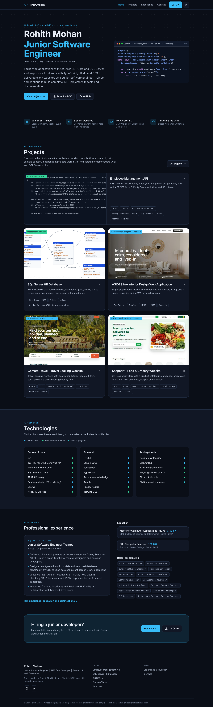
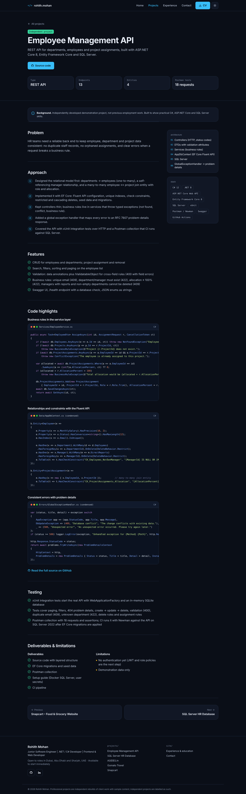
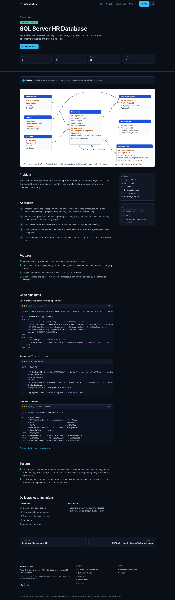
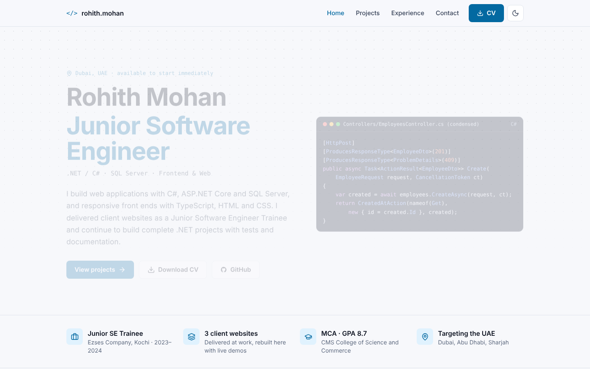
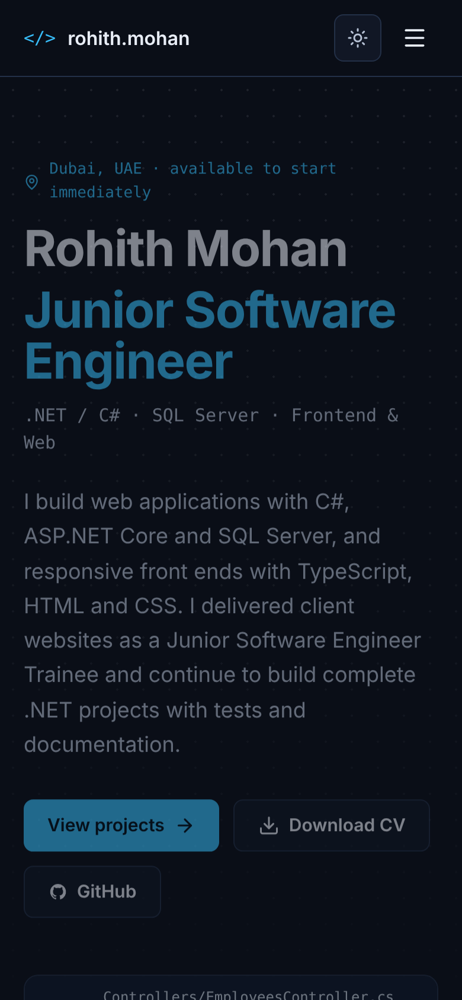

# Rohith Mohan – Software Engineering Portfolio

Portfolio website for **Rohith Mohan, Junior Software Engineer** (.NET / C#, SQL Server, frontend and web development), targeting roles in Dubai, Abu Dhabi and Sharjah.

**Live site:** https://rohithmohan123.github.io/rohith-mohan-software-engineering-portfolio/



## Overview

A fast, static developer portfolio with a dark/light theme. A recruiter sees the name, role and core stack in the first screen. Every project has its own case study (problem, approach, features, code highlights, testing, deliverables and limitations) with links to the source code and, where possible, a live demo.

| Project | Type | Links |
|---|---|---|
| Employee Management API (ASP.NET Core 8, EF Core, SQL Server) | Independent project | [Code](https://github.com/Rohithmohan123/employee-management-api-dotnet) |
| SQL Server HR Database (schema, joins, views, stored procedures) | Independent learning project | [Code](https://github.com/Rohithmohan123/sql-server-hr-database-demo) |
| ASIDES.in – Interior Design Web Application | Professional project, rebuilt | [Live](https://rohithmohan123.github.io/asides-interior-design-web-application/) · [Code](https://github.com/Rohithmohan123/asides-interior-design-web-application) |
| Gomato Travel – Travel Booking Website | Professional project, rebuilt | [Live](https://rohithmohan123.github.io/gomato-travel-booking-website/) · [Code](https://github.com/Rohithmohan123/gomato-travel-booking-website) |
| Snapcart – Food & Grocery Website | Professional project, rebuilt | [Live](https://rohithmohan123.github.io/snapcart-food-grocery-website/) · [Code](https://github.com/Rohithmohan123/snapcart-food-grocery-website) |

## Honesty notes

- **Professional experience and independent projects are kept separate** on every page.
- The three professional projects are client websites from my time as a Junior Software Engineer Trainee. The versions here are independent rebuilds with sample content; no client code or data is included.
- The .NET API and the SQL Server database were built independently to demonstrate those skills. They are labelled as such and are not presented as employment work.
- The tech-stack section marks each skill as "used at work", "independent projects" or both.
- Code highlights are copied from the linked repositories; shortened excerpts are marked "condensed".

## Technology

- Next.js 16 (App Router) with static export · React 19 · TypeScript
- Tailwind CSS 4 with CSS-variable themes (dark default, light option, remembered per visitor, no flash on load)
- Lucide icons · a small built-in syntax highlighter for C#, T-SQL and JavaScript
- Playwright (Chrome) for the end-to-end test and CV generation

## Folder structure

```
├── src/
│   ├── app/                     # Home, projects, projects/[slug], experience, contact, sitemap, robots
│   ├── components/              # Header, Footer, ThemeToggle, ProjectCard, Code, ContactForm, icons
│   ├── data/projects.ts         # All case-study content and code highlights
│   └── lib/site.ts              # Personal details, experience, education, stack
├── public/
│   ├── cv/                      # Generated CV (PDF)
│   └── images/                  # Screenshots of the live project sites, ER diagram
├── scripts/build-pdfs.mjs       # Builds the CV from the same data as the site
├── tests/e2e.mjs                # Browser test of the built site
└── .github/workflows/deploy.yml # GitHub Pages deployment
```

## Install and run

Requires Node.js 20.9+ (22 recommended).

```bash
git clone https://github.com/Rohithmohan123/rohith-mohan-software-engineering-portfolio.git
cd rohith-mohan-software-engineering-portfolio
npm install
npm run dev        # http://localhost:3000
```

Edit `src/lib/site.ts` (details) and `src/data/projects.ts` (projects). Rebuild the CV with `npm run pdfs`.

## Build and test

```bash
npm run build            # static site in out/
npm test                 # browser checks (needs Chrome; set CHROME_PATH if needed)
E2E_OFFLINE=1 npm test   # same, without loading web fonts
```

The test checks every page (one `h1`, unique titles), every internal link and the CV download, the sections of each case study, project labels and code highlighting, the theme toggle (including persistence), contact-form validation, no horizontal scroll at 390 px, the mobile menu and no console errors. Current result: **10/10 passing**.

## Deployment

**GitHub Pages (live site):** `.github/workflows/deploy.yml` builds with `NEXT_PUBLIC_BASE_PATH=/<repo-name>` and publishes `out/` on every push to `main`. In the repository settings, set Pages → Source to **GitHub Actions**.

**Vercel / Netlify:** import the repository with the default Next.js settings (build `npm run build`, output `out`). Leave `NEXT_PUBLIC_BASE_PATH` unset.

## Screenshots

| | |
|---|---|
|  .NET API case study |  SQL Server case study |
|  Light theme |  Mobile |

## Limitations

- Static site: the contact form opens the visitor's email app (or copies the message for LinkedIn) rather than sending mail through a server.
- The .NET API is not hosted (GitHub Pages serves static files only); its repository documents local setup and CI runs it against SQL Server.

## Licence

MIT, see [LICENSE](LICENSE).
